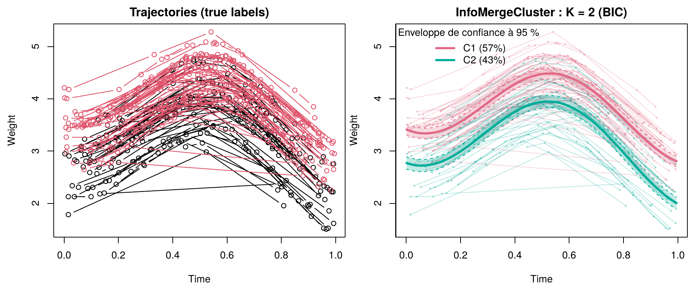

# InfoMergeCluster

[](https://github.com/noukpoape/InfoMergeCluster/actions/workflows/R-CMD-check.yaml)

**Clustering of sparse longitudinal data with automatic selection of the number of clusters.**

`InfoMergeCluster` groups subjects followed over time — with few, irregular
measurements per subject — into clusters of similar trajectories. It is a
mixture of linear mixed models:

- each cluster has a smooth mean trajectory (penalized B-splines, smoothing
  parameter estimated automatically);
- individual deviations are captured by a random effect: intercept, linear
  (default) or spline;
- conjugate priors on the variance structure, calibrated on the empirical
  variogram of the residuals, keep the fit stable, even for data without
  measurement error;
- optional covariates act on the trajectories (cluster-specific effects) and,
  if requested, on the cluster proportions;
- the number of clusters is selected by BIC or ICL, or imposed with `K`;
- confidence and prediction envelopes, predicted individual trajectories and a
  stability diagnostic across random seeds are included.

The package only depends on base R (`stats`, `splines`, `graphics`,
`grDevices`, `utils`).

## Installation

```r
# install.packages("remotes")
remotes::install_github("noukpoape/InfoMergeCluster")
```

## Theoretical background

### Statistical problem

We observe $`N`$ subjects. Subject $`i`$ is measured $`n_i`$ times, at times
$`0 \le t_{i1} < \dots < t_{in_i} \le 1`$, and $`\mathbf{y}_i = (y_{i1}, \dots, y_{in_i})^\top`$
denotes its measurements. The population is assumed to consist of $`K`$ unknown
sub-populations whose mean trajectories $`f_1, \dots, f_K`$ differ. The goal is
threefold:

1. estimate the number of clusters $`K`$;
2. assign each subject to a cluster (estimate the partition);
3. estimate the mean trajectories $`f_k`$.

Two features make the problem hard. The data are **sparse**: $`n_i`$ is small,
so no individual trajectory can be reconstructed accurately. They are
**irregular**: measurement times differ from one subject to another, so the
data cannot be arranged in a *subjects × times* table. Two-step methods (smooth
each curve, then cluster the smoothed curves) fail, because the reconstruction
error is of the same order as the differences between clusters.

Trajectories are represented on a B-spline basis,

```math
f(t) = \sum_{j=1}^{p} \beta_j B_j(t) = \mathbf{B}(t)^\top \boldsymbol\beta ,
```

where the $`B_j`$ are piecewise polynomials of degree 3 joined at knots, and
$`\mathbf{B}_i \in \mathbb{R}^{n_i \times p}`$ is the matrix with entries
$`B_j(t_{il})`$. The whole difficulty is to estimate *cluster* coefficients
$`\boldsymbol\beta`$ while no subject provides enough measurements to estimate its own.

### Model: a mixture of linear mixed models

Each subject belongs to a latent cluster $`z_i`$ and, conditionally on its
cluster,

```math
\mathbf{y}_i \mid z_i = k \;=\;
\underbrace{\mathbf{B}_i \boldsymbol\beta_k}_{\text{cluster trajectory}}
+ \underbrace{\mathbf{Z}_i \mathbf{u}_i}_{\text{individual deviation}}
+ \underbrace{\boldsymbol\varepsilon_i}_{\text{noise}},
\qquad
\mathbf{u}_i \sim \mathcal{N}_q(\mathbf{0}, \mathbf{G}),
\quad
\boldsymbol\varepsilon_i \sim \mathcal{N}(\mathbf{0}, \sigma^2 \mathbf{I}),
```

with $`\Pr(z_i = k) = \pi_k`$. The random effect $`\mathbf{u}_i`$ describes how a
subject departs from its cluster trajectory; the design $`\mathbf{Z}_i`$ sets its
shape: a level shift ($`\mathbf{Z}_i = \mathbf{1}`$, `re = "intercept"`), a line
($`\mathbf{Z}_i = [\mathbf{1}, \mathbf{t}_i]`$, `re = "linear"`) or a spline
($`\mathbf{Z}_i = \mathbf{B}_i`$, `re = "spline"`). Integrating out
$`\mathbf{u}_i`$, a subject of cluster $`k`$ is Gaussian:

```math
\mathbf{y}_i \mid z_i = k \sim \mathcal{N}\big(\mathbf{B}_i\boldsymbol\beta_k,\; \mathbf{V}_i\big),
\qquad
\mathbf{V}_i = \mathbf{Z}_i \mathbf{G} \mathbf{Z}_i^\top + \sigma^2 \mathbf{I}.
```

> **Why a random effect changes everything.** Without a random effect, two
> measurements of the same subject would be independent given its cluster, and
> any level difference between a subject and its cluster would be "noise". With
> a random effect, the model knows that a subject can be globally higher than
> its cluster without changing cluster. The counterpart: a *level* difference
> between two clusters looks like an individual effect, and only brings a
> bounded amount of information per subject, whatever its number of
> measurements.

### Information statistics

For a fixed variance structure $`(\mathbf{G}, \sigma^2)`$, each subject is
summarized by

```math
\mathbf{A}_i = \mathbf{B}_i^\top \mathbf{V}_i^{-1} \mathbf{B}_i,
\qquad
\mathbf{b}_i = \mathbf{B}_i^\top \mathbf{V}_i^{-1} \mathbf{y}_i ,
```

and the log-likelihood of subject $`i`$ in cluster $`k`$ is, up to a constant $`c_i`$,
$`\boldsymbol\beta_k^\top \mathbf{b}_i - \tfrac12 \boldsymbol\beta_k^\top \mathbf{A}_i \boldsymbol\beta_k`$.
The matrix $`\mathbf{A}_i`$ is the Fisher information that the subject brings on
the coefficients of its cluster. Its rank is at most $`n_i < p`$: a single subject
does not identify $`\boldsymbol\beta_k`$, but the informations *add up* over the
subjects of a cluster.

### Estimation

For a fixed $`K`$, the penalized likelihood

```math
\ell^{\text{pen}}(\boldsymbol\theta)
= \sum_{i=1}^{N} \log \sum_{k=1}^{K} \pi_k\, \varphi\big(\mathbf{y}_i;\, \mathbf{B}_i\boldsymbol\beta_k,\, \mathbf{V}_i\big)
- \frac{\lambda}{2} \sum_{k=1}^{K} \boldsymbol\beta_k^\top \mathbf{P} \boldsymbol\beta_k ,
\qquad
P_{jl} = \int_0^1 B_j''(u)\, B_l''(u)\, du ,
```

is maximized, where the O'Sullivan penalty measures the curvature of the mean
trajectories (penalized B-splines). The EM algorithm alternates:

- **E step**: posterior probabilities
  $`\tau_{ik} \propto \pi_k \exp\big(\boldsymbol\beta_k^\top \mathbf{b}_i - \tfrac12 \boldsymbol\beta_k^\top \mathbf{A}_i \boldsymbol\beta_k\big)`$;
- **M step**: $`\pi_k = \frac1N \sum_i \tau_{ik}`$ and
  $`\boldsymbol\beta_k = \big(\sum_i \tau_{ik} \mathbf{A}_i + \lambda \mathbf{P}\big)^{-1} \sum_i \tau_{ik} \mathbf{b}_i`$,
  a generalized ridge regression that pools the information of all the
  subjects of the cluster;
- update of $`(\mathbf{G}, \sigma^2)`$ through the conditional expectations of
  $`\mathbf{u}_i`$, and of $`\lambda`$ by the Fellner–Schall iteration.

The EM is accelerated by SQUAREM. Since the likelihood of a mixture has many
local maxima, the initialization matters: InfoMergeCluster builds a **merge
tree**, starting from an over-segmentation into micro-clusters and merging, at
each step, the two clusters whose merge most increases the exact integrated
completed likelihood, computable in $`O(p^3)`$ thanks to the additivity of
$`(\mathbf{A}_i, \mathbf{b}_i)`$.

### Priors on the variance structure

The random-effect covariance and the residual variance are given conjugate
priors,

```math
\mathbf{G} \sim \mathcal{IW}_q(\nu_0, \boldsymbol\Psi_0),
\qquad
\sigma^2 \sim \mathcal{IG}(a_\sigma, b_\sigma),
```

and the estimator becomes the posterior mode. The M steps for
$`(\mathbf{G}, \sigma^2)`$ read

```math
\mathbf{G} \leftarrow \frac{N \boldsymbol\Sigma_G + \boldsymbol\Psi_0}{N + \nu_0 + q + 1},
\qquad
\sigma^2 \leftarrow \frac{\sum_i n_i\, \hat\sigma^2_{\text{EM}} + 2 b_\sigma}{\sum_i n_i + 2 a_\sigma + 2}.
```

The hyperparameters are calibrated on the **empirical variogram** of the
residuals of the one-class model: for two measurements of the same subject,
$`v = (r_{ij} - r_{ik})^2 / 2`$ and $`u = |t_{ij} - t_{ik}|`$. The smooth
components vanish as $`u \to 0`$, so the intercept (the *nugget*) estimates
$`\sigma^2`$; the *sill* is the variance of the residuals. The prior mode of
$`\sigma^2`$ is the nugget, and that of $`\mathbf{G}`$ attributes half of the gap
between sill and nugget to the random effect ($`\nu_0 = q`$, $`a_\sigma = 1`$).
These priors prevent the residual variance from collapsing when the data are
nearly exact. They are always active and calibrated automatically. The
log-likelihood used in the BIC remains $`\ell`$, without the prior.

### Covariates

With `n_cov > 0`, covariates $`\mathbf{X}_i`$ (one value per measurement,
constant within a subject or time-varying) act on the trajectories with
cluster-specific effects $`\boldsymbol\gamma_k`$:

```math
\mathbf{y}_i \mid z_i = k = \mathbf{B}_i \boldsymbol\beta_k + \mathbf{X}_i \boldsymbol\gamma_k + \mathbf{Z}_i \mathbf{u}_i + \boldsymbol\varepsilon_i .
```

The basis is augmented to $`[\mathbf{B}_i \mid \mathbf{X}_i]`$ and the penalty to
$`\mathrm{diag}(\mathbf{P}, \mathbf{0})`$ ($`\boldsymbol\gamma_k`$ is not
smoothed); the information statistics, the EM and the exact merge cost are
unchanged in dimension $`p + r`$. Covariates are centered, so that
$`\boldsymbol\beta_k`$ describes the mean trajectory at the mean covariate values.
With `weights = "covariates"`, the cluster proportions also depend on the
covariates (concomitant variables),
$`\pi_k(\mathbf{x}_i) = \exp(\mathbf{w}_i^\top\boldsymbol\alpha_k) / \sum_l \exp(\mathbf{w}_i^\top\boldsymbol\alpha_l)`$,
with $`\mathbf{w}_i = (1, \bar{\mathbf{x}}_i)`$; the M step for
$`\boldsymbol\alpha`$ is a weighted multinomial logistic regression.

### Choice of K

The model is fitted for $`K = 1, \dots, K_{\max}`$ and the minimum of

```math
\mathrm{BIC}(K) = -2\, \ell(\hat{\boldsymbol\theta}_K) + d_K \log N,
\qquad
d_K = (K - 1) + \underbrace{\sum_k \mathrm{tr}\big(\mathbf{H}_k^{-1} \mathbf{A}^{(k)}\big)}_{\text{effective degrees of freedom}} + \frac{q(q+1)}{2} + 1
```

is retained (the ICL adds the entropy of the partition). Since the grid starts
at $`K = 1`$, the BIC can conclude that there is no cluster structure. The
number of clusters can also be imposed with `K`: the model is then fitted
directly with `K` clusters.

## Usage

The example below uses scenario 1 of the built-in data generator with its
reference settings: 100 curves in 2 groups (43 and 57 curves), each observed
at 2 to 10 random times.

```r
library(InfoMergeCluster)

# scenario 1 with its reference settings: 2 groups of 43 and 57 curves
set.seed(1)
gen <- f.data.generation(senario = 1, n.k = c(43, 57), n.cts = c(1.8, 2.4), n.min = 2)
true_groups <- attr(gen$liste, "groupe")

# trajectories with their true groups
plot.data(gen$liste, legend = TRUE)

# automatic selection of the number of clusters (BIC), random intercept
# gen$df is a long data.frame: 1st column = id, second-to-last = time, last = response
fit <- infomergecluster(gen$df, K_max = 5, df = 20, re = "intercept")
fit                                   # selected K, proportions, criteria
plot(fit, envelope = TRUE)            # trajectories, mean curves, 95% band

# number of clusters imposed by the user (no selection)
fit2 <- infomergecluster(gen$df, K = 2, df = 20, re = "intercept")

# the list format (one matrix per curve) gives the same kind of fit
fit2_list <- infomergecluster(gen$liste, K = 2, df = 20, re = "intercept")

# agreement with the true groups
table(fit2$cluster, true_groups)
adjusted_rand(fit2$cluster, true_groups)

# mean curves with prediction envelope, predicted individual curves
head(predict(fit2, interval = "prediction"))
curves <- fitted_curves(fit2)

# stability across seeds
st <- infomergecluster_stability(gen$df, K_max = 5, df = 20, re = "intercept", seeds = 1:5)
st$stability$mean_ari
```

Clustering of scenario S1 (first replication of the simulation study, reference
settings, 20 B-splines, random intercept, `K = 2` imposed). Left: trajectories
colored by their true group, true mean curves in black. Right: partition and
mean curves estimated by InfoMergeCluster (thick lines), true mean curves
dashed. The two clusters gather trajectories of the same *shape* at various
levels: the random intercept absorbs the individual level, and the partition
is driven by the shape.



### With covariates

With covariates, the columns are read by position: identifier, time, response,
then the `n_cov` covariates.

```r
dat <- gen$df[, c("id", "x", "y")]
dat$sex <- rep(sample(c("F", "M"), 100, replace = TRUE), table(dat$id))

# covariate effects on the trajectories, specific to each cluster
fit_cov <- infomergecluster(dat, K = 2, n_cov = 1)
fit_cov$gamma

# cluster proportions depending on the covariate
fit_w <- infomergecluster(dat, K = 2, n_cov = 1, weights = "covariates")
fit_w$alpha

# mean curves for a given covariate value (dummy-coded: sexM = 1)
head(predict(fit_cov, covariates = 1))
```

## Simulated scenarios

`f.data.generation()` provides the four scenarios S1 to S4 of Zhou, Zhang and
Tu (2023), the article that introduced the clusterMLD method. The reference
data sets (study A of the simulation study of InfoMergeCluster) use the
following settings; no measurement error is added, and subjects differ by a
random intercept.

| Scenario | K | N   | Group sizes `n.k`          | Shifts `n.cts`            | `n.min` | Measurements per subject |
|:--------:|:-:|:---:|----------------------------|---------------------------|:-------:|:------------------------:|
| S1       | 2 | 100 | **`c(43, 57)`**            | `c(1.8, 2.4)`             | 2       | 2–10                     |
| S2       | 3 | 150 | **`c(35, 43, 72)`**        | `c(2, 2.3, 2.7)`          | 3       | 3–11                     |
| S3       | 4 | 200 | **`c(34, 67, 71, 28)`**    | `c(0.9, 1.5, 2.2, 2.4)`   | 3       | 3–11                     |
| S4       | 5 | 310 | **`c(60, 85, 45, 70, 50)`** | `rep(0, 5)`              | 3       | 3–11                     |

```r
s1 <- f.data.generation(1, n.k = c(43, 57),             n.cts = c(1.8, 2.4),           n.min = 2)
s2 <- f.data.generation(2, n.k = c(35, 43, 72),         n.cts = c(2, 2.3, 2.7),        n.min = 3)
s3 <- f.data.generation(3, n.k = c(34, 67, 71, 28),     n.cts = c(0.9, 1.5, 2.2, 2.4), n.min = 3)
s4 <- f.data.generation(4, n.k = c(60, 85, 45, 70, 50), n.cts = rep(0, 5),             n.min = 3)
```

The default arguments (`n.k = c(20, 30)`, `n.cts = c(1.8, 2.4)`, `n.min = 2`)
give a small two-group data set. See `?f.data.generation` for the mean curves
of each scenario.

**Source of the scenarios.** Zhou, J., Zhang, Y. and Tu, W. (2023).
clusterMLD: An efficient hierarchical clustering method for multivariate
longitudinal data. *Journal of Computational and Graphical Statistics*, 32(3),
1131–1144. [doi:10.1080/10618600.2022.2149540](https://doi.org/10.1080/10618600.2022.2149540)

## Main arguments of `infomergecluster()`

| Argument    | Meaning                                                                  |
|-------------|--------------------------------------------------------------------------|
| `K`         | imposed number of clusters (`NULL` = automatic selection)                |
| `K_max`     | largest number of clusters examined when `K = NULL`                      |
| `criterion` | `"BIC"` or `"ICL"`                                                       |
| `re`        | random effect: `"linear"` (default), `"intercept"` or `"spline"`         |
| `df`        | number of B-spline functions                                             |
| `n_cov`     | number of covariates (columns after identifier, time and response)      |
| `weights`   | `"constant"` proportions or proportions depending on the `"covariates"`  |
| `min_size`  | minimum cluster size                                                     |

See `?infomergecluster` for the full list.

## Citation

If you use `InfoMergeCluster` in a publication, please cite it as:

> Noukpoape, K. M. and Preda, C. (2026). *InfoMergeCluster: Clustering of Sparse
> Longitudinal Data with Automatic Selection of the Number of Clusters.*
> R package version 1.0.0. https://github.com/noukpoape/InfoMergeCluster

BibTeX:

```bibtex
@manual{noukpoape2026infomergecluster,
  title={InfoMergeCluster: Clustering of Sparse Longitudinal Data with Automatic Selection of the Number of Clusters},
  author={Noukpoape, Komlan Midodzi and Preda, Cristian},
  year={2026},
  note={R package version 1.0.0},
  url={https://github.com/noukpoape/InfoMergeCluster}
}
```

The package itself gives this reference:

```r
library(InfoMergeCluster)
infomergecluster_citation()                     # BibTeX entry above
infomergecluster_citation("text")               # plain-text reference
infomergecluster_citation(file = "refs.bib")    # append it to a .bib file
citation("InfoMergeCluster")                    # standard R citation

# the .bib file installed with the package
system.file("CITATION.bib", package = "InfoMergeCluster")
```

It is also available on GitHub through the **Cite this repository** button
(file `CITATION.cff`).

## Authors

- Komlan Midodzi Noukpoape (maintainer) — <noukpoape@gmail.com>
- Cristian Preda

## License

MIT © Komlan Midodzi Noukpoape
